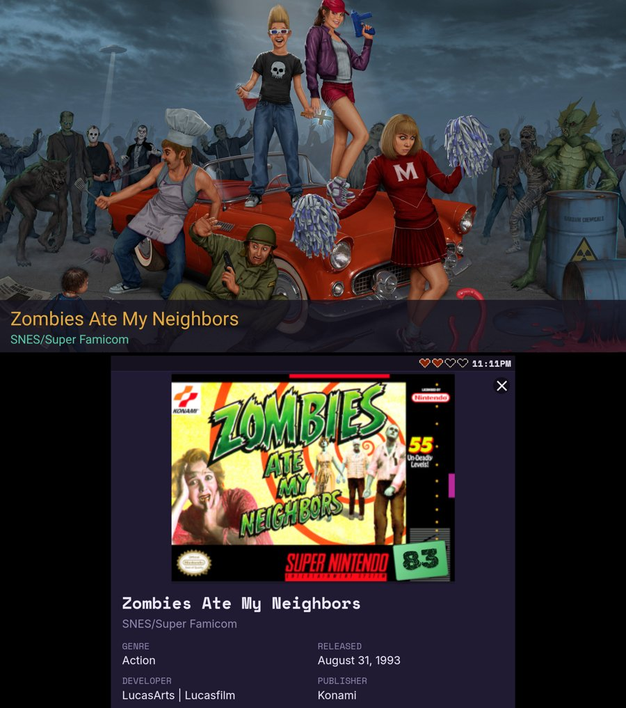
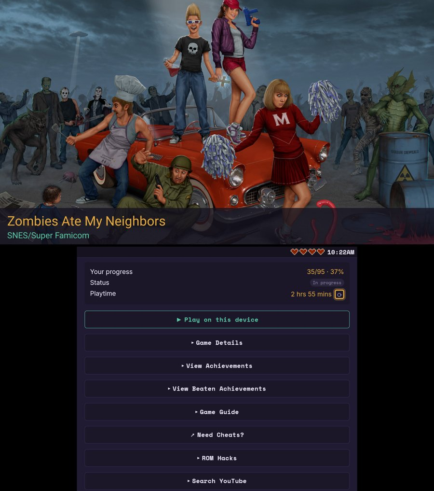

# Game Log Tracker DS Launcher

Game Log Tracker DS Launcher is the Android app version you've been waiting for, built for two screen devices like the AYN Thor and the Retroid Pocket Duo. 

Track your RetroAchievements and completions on the bottom screen, see your game's art on the top screen, and start your games in RetroArch or a standalone emulator with one tap. It also works on single-screen Android devices or Phones. 

Everything you add is saved on your own device in your choice of local or default system folder.

Join the Gin649sRetroGameHub Discord: https://discord.gg/6dgZA4yD2

For all app related discussions and my Game of the Month Competition. Play some games with us.

## What it does

**Two screens, one app.** The bottom screen is the Game Log Tracker. The top screen shows art for the game you have open, or the logo on the main menu. Open a game, press Play, and it starts on the top screen. The tracker remains on the bottom screen to keep track of your game. When the game closes, the top screen returns to showing fan art and menus etc.

**The tracker** is the full Game Log Tracker web app, bundled along with many improvements. 

- **Overview** with your RetroAchievements profile, recently played games and your latest unlocks.
- **Game Library** with every game you've played on RA. Search it, filter by system, and see progress, awards and playtime. The three games you played most recently sit at the top, then everything else is listed by name. Tap a column heading to sort by anything else. Pick a console and the top three are the last ones you played on that console.
- **Beaten by Year** groups everything you've beaten or mastered by the year you did it.
- **Backlog** is for games you plan to play, including games from systems RA doesn't track. It's sorted by name. Besides searching by title, Add game can pick games straight from your ROM files (several at once), or add every game in a system folder. Each is matched to its RetroAchievements entry by name, and one RA doesn't list is added as a plain entry, and its picture is filled in from your frontend's media, then SteamGridDB (with a key), LaunchBox, then RAWG.
- **Social** shows the people you follow on RetroAchievements and what they've unlocked lately.
- **Casual / Hardcore** is one switch in the menu that flips every stat, list and progress bar.

The web version has the full details: https://github.com/Gin649/Game-Log-Tracker

### Inside a game

- **Retro Achievements** list with points and unlock dates, missable achievements marked with a "!", and a Missable Only filter. Put achievements in your own order, and export or import an order as a file. Also included are Subsets, if the game has any, each with its own achievement list.
- **Game Details** More information about a game, including its RA time to beat and master.
- **Game manuals.** Find and download a manual for the game, then read it in the built-in viewer. It's saved on your device and works with the controller too.
- **Guides and Walkthroughs.** Find a walkthrough opens a browser inside the app. Back, or a swipe from the edge, returns to the tracker, and Save video keeps the link in the game's profile.
- **ROM Hacks.** The app finds your base ROM for you. The patched ROM is saved next to it, with a "Play patched ROM" button and an "Add to my backlog" option. Translations are listed in their own section. Hacks that were made for your exact ROM are found from a ready-made list that updates itself, so the search is quick. I don't host or supply any ROMs.
- **Disc games too.** ROM Hacks also works for CD and DVD games (PlayStation, Saturn, Sega CD, GameCube and so on). Discs are patched straight from storage, with a progress bar, and the patched copy is saved next to the original, which is never changed. It works with BIN/CUE, ISO, CSO, CHD and RVZ games, and with IPS, PPF, BPS, UPS and xdelta patches. CHD and RVZ games are unpacked, patched and packed again, which takes longer and needs free space for the whole disc.

### On the top screen

The top screen shows the game you have open, with its title and system underneath. It also carries your profile card and the menu, so the bottom screen stays free for the tracker.

Art you already have is never downloaded again. Opening a game that has no art fetches it in the background, and Fetch game art (in the menu under Data) does the games in your Library and Backlog.

When a game has several fan arts online (up to six), swipe left or right on the top screen to pick one; the choice is remembered. 

### Playing your games

- **RetroArch** starts the game with the right core for the system.
- **Standalone emulators:** Dolphin (GameCube, Wii), DuckStation (PS1), PPSSPP (PSP), Mupen64Plus (N64), ARMSX2 (PS2), WatermelonDS (DS), Azahar (3DS), Eden (Switch), Cemu (Wii U), Vita3K (Vita) and HakuX (Xbox).
- You choose which emulator or RetroArch core each system uses, and you can change it any time from Launcher settings.
- The app reads your ROMs folder, whether you use ES-DE or no frontend at all. Folders named in full, like "Game Boy Advance" or "SNES", are recognised too.
- Some of the newer emulator setups are still being tested. If one opens but doesn't start your game, tell me on Discord.

### Controller controls

| Button | Action |
| --- | --- |
| D-pad / left stick | Move the highlight |
| Right stick | Scroll up and down (faster the further you push) |
| A | Confirm (can be swapped with B in the menu under Controller) |
| B | Back: closes the game profile, pop-ups, the manual, the menu or the on-screen keyboard |
| Select | Open or close the menu |
| X | Refresh the game profile or the main screen |
| L1 / R1 | Previous / next console |
| L2 / R2 | Previous / next tab |

### Other things

- Text size controls in the menu, and a tracker size setting for the bottom screen in Launcher settings.
- An optional clock and battery readout, with the battery shown as pixel hearts. Turn it on under Display in the menu.
- The app checks for new versions and offers to download and install them.
- About, at the bottom of the menu, shows the app version and links to GitHub and Discord.

## Screenshots

A game profile on the Thor, with the fan art and title on the top screen and the tracker on the bottom screen.

<table>
  <tr>
    <td></td>
    <td></td>
  </tr>
</table>

## Getting started

1. Download the latest `.apk` from the Releases page: https://github.com/Gin649/Game-Log-Tracker-DS-Launcher/releases
2. Install it. Android will ask you to allow installing from your browser or file manager the first time.
3. Open the app. The setup wizard will open.
4. Follow the wizard. It asks for:
   - **File access** so the app can find your games and artwork, and **usage access** so the top screen returns to the tracker when a game closes.
   - Mandatory: Your RetroAchievements username and Web API key. You can find the key on RA under Control Panel, then Keys.
   - Optional but recommended to get full experience: a free RAWG key for ratings and game details, and a free SteamGridDB key for fan art. Launchbox artwork doesn't need a key and will be used by default if you don't give one.
   - For single screen devices uncheck launchbox and leave the steamgriddb blank. All artwork scraped is for the top screen and not needed for single screen devices.
   - Which frontend you use (ES-DE or none), your ROMs folder, and the frontend's media folder if you use ESDE. If you you select none, new fan art will be scraped as you navigate game library.
   - Which emulator to use for each system. Only systems found in your Roms folder and emulators/cores on your device are listed.
   - Which screen is the top screen, and how big the text on the tracker should be on the bottom screen. This is automatically configured. For single screen just leave it on automatic. 
5. Tap Finish. You can change any of it later from the tracker's menu, under Launcher settings.

**Coming from the web version?** The app keeps its own data, so move yours over once. In the web version choose Menu, then Data, then Export. In the app choose Menu, then Data, then Import.

## Your data

Everything is stored on your device: your RA login, keys, added games, playtime, custom achievement orders, guides, manuals and saved videos. Nothing syncs between devices.

The app keeps its own files (that saved data, plus fetched game art) in a folder you choose in the setup wizard, under Your folders. The default is a GameLogTracker folder in shared storage, so it survives uninstalling the app and switching between debug and release builds. Changing the folder moves what is already saved. Without file access the app falls back to its private folder.

## Privacy

None of your data is stored by me, and the app has no analytics or tracking. RetroAchievements requests go straight from the app to RetroAchievements. Your optional RAWG and SteamGridDB keys are only sent to those services.

Other sites the app contacts, and why:

- RetroAchievements and media.retroachievements.org, for your profile, achievements and images.
- RAWG, for ratings and game details (only if you added a key).
- SteamGridDB, for fan art (only if you added a key).
- LaunchBox's games database, for free fan art, box art, screenshots and logos. A small index per console is downloaded from this repo and the pictures from images.launchbox-app.com. This is on by default and can be switched off in Launcher settings.
- YouTube, for walkthrough videos.
- archive.org, for text guides.
- gamesdatabase.org, for game manuals. Those requests go through a private proxy I run on Cloudflare Workers that stores nothing.
- cdnjs.cloudflare.com, to load the manual viewer the first time you open a manual.
- GitHub, to check for new app versions and to find ROM patches and guides.

## Changelog

See [CHANGELOG.md](CHANGELOG.md) for what changed in each version.

## Contact

Questions or bugs: find me on Discord or 
Email: ginsretrogamehub@gmail.com   
